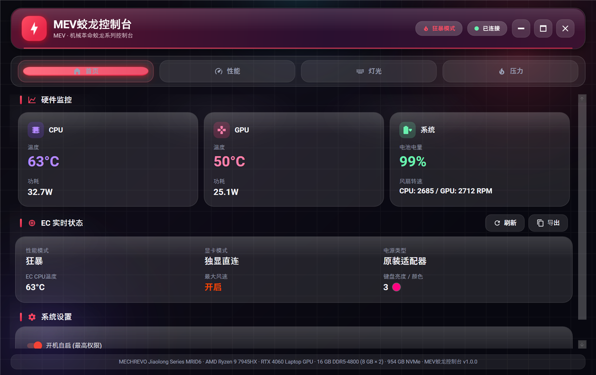
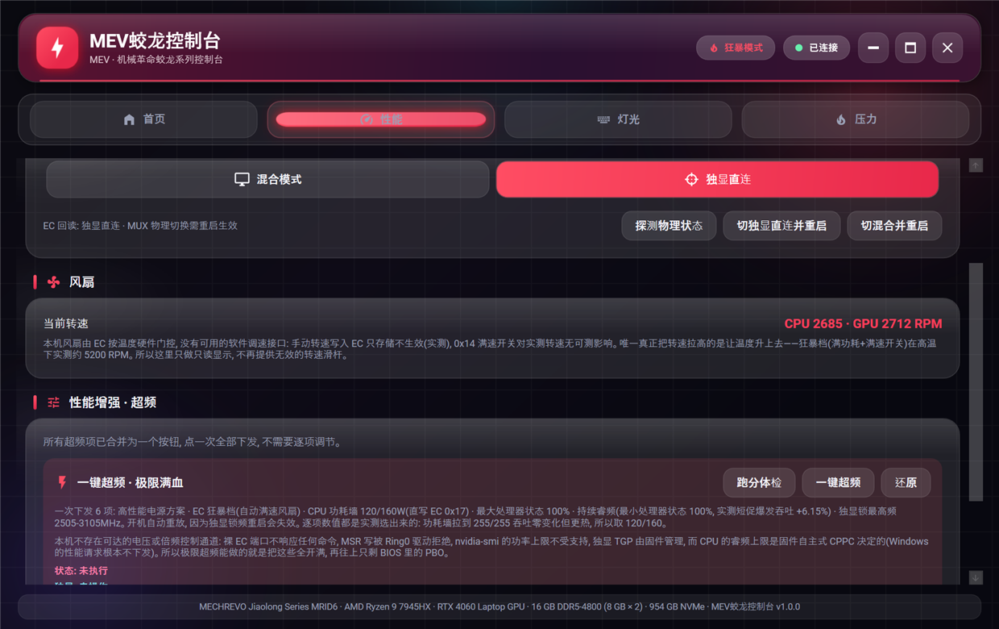
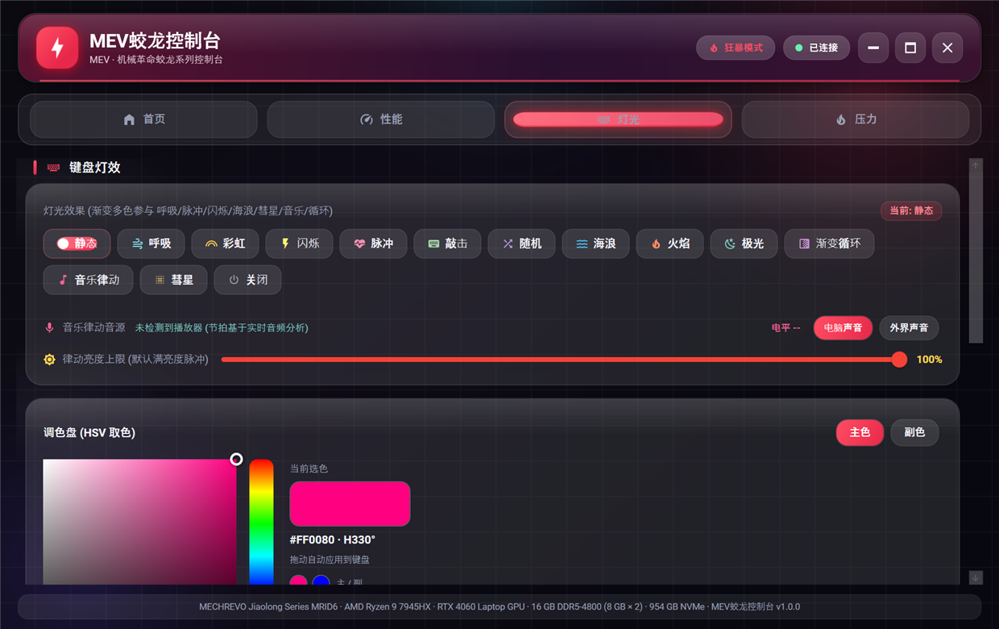
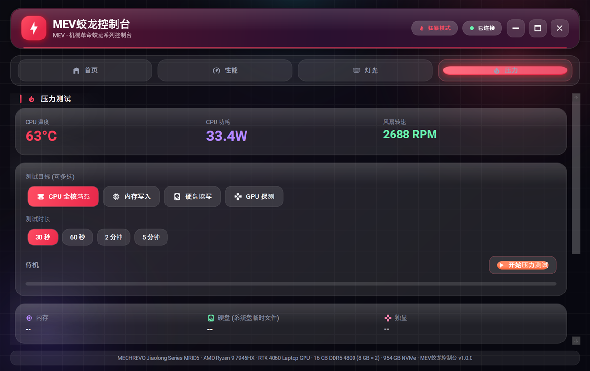

# MEV蛟龙控制台 - MEV Jiaolong Control Center

[](LICENSE)
[](https://dotnet.microsoft.com/)
[]()

MEV蛟龙控制台 — 机械革命蛟龙系列（同方模具）的第三方控制台，实测机型 R9 7945HX + RTX 4060。

作者：**TianMing** · 许可证：MIT · 仅提供安装版

## 功能特性

- **性能模式切换** - 办公 / 游戏 / 狂暴（EC 命令 0x08）
- **显卡模式切换** - 混合 / 独显直连（EC 命令 0x09，切换后需重启）
- **CPU 功耗墙** - SPL/SPPT 直写 EC 0x17 并回读校验（实测取 120/160W）
- **一键极限满血** - 一次下发 6 项（电源方案 / 狂暴档 / 功耗墙 / 最大处理器状态 / 持续睿频 / 独显锁频），开机自动重放
- **硬件监控** - CPU/GPU 温度、功耗、全核频率/负载、显存、内存（含虚拟内存）、风扇、电池
- **CPU / 内存 / 硬盘详细数据** - CPU 型号/核心/缓存 + 每核频率/VID/负载/功耗；内存条/虚拟内存；NVMe 双温度/损耗/备用块/阈值/累计读写/活动
- **GPU 详情** - 驱动版本、核心/显存当前与最大频率、GPU/显存占用、VRAM 已用/空闲、功耗/上限、P-State、PCIe 链路、风扇
- **电池/充电详情** - 状态、电量、充放电功率/电压/电流、容量健康与损耗、剩余/满充/设计容量、循环次数、型号/化学体系/设计电压、适配器类型、预计可用/充满时间
- **系统调节** - 电源方案、屏幕刷新率、内置屏亮度、系统音量/静音（**静音锁定**，其它程序调音量不会解除）
- **键盘灯效** - 静态/呼吸/流光/波浪/律动等，多色渐变、动态随机漂移、音乐律动
- **A 面 Logo 背光** - 独立开关（EC 命令 0x0F，实测可写可回读；该硬件无独立颜色通道）
- **压力测试（按机器自适应）** - CPU 用全部逻辑处理器；内存按物理总量/当前可用内存定量并多线程写入（上限 16GB，给系统留 2GB）；磁盘按剩余空间定量（上限 4GB）；GPU 状态探测（无 NVIDIA 时禁用）；结束后给出最小/平均/最大结果
- **系统托盘** - 后台运行，快速切换模式
- **开机自启** - 计划任务 + 最高权限，登录即启动
- **全界面实时刷新** - 温度/功耗/风扇/EC 档位/电压/每核频率/设备详情/快捷控制全部随数据源实时变化，与当前所在页面无关，不做「切到别的页面就停刷新」

> 风扇转速由 EC 按温度硬件门控，没有可用的软件调速接口（实测手动写入只存不生效），
> 因此界面只做只读显示，不提供无效的转速滑杆。

> 资源占用（本机 16GB / R9 7945HX 实测）：
> - 空闲常驻：主程序约 230MB 工作集、190–230MB 私有内存，内置 WMI 桥约 23MB（替代原先约 100MB 的 PowerShell 桥）。
> - 收进托盘后自动把工作集交还系统（私有内存不变，重新显示时按需换回）。
> - 内存压测用非托管内存，停止后立刻归还系统：5GB 压测停止 1 秒内回落，之前用托管大对象会永久滞留 4.3GB。
> - 键盘色块画刷按颜色复用、磁盘压测读写共用缓冲区，避免每秒/每轮新建对象。

## 界面预览

| 首页 · 硬件监控 | 性能 · 显卡模式与一键超频 |
|---|---|
|  |  |

| 灯光 · 键盘灯效与 HSV 调色 | 压力 · CPU/GPU/内存/磁盘压测 |
|---|---|
|  |  |

## 系统要求

- Windows 10 1809+ / Windows 11 (x64)
- .NET 8 桌面运行时（**安装包会检测，缺失时自动下载并静默安装，完成后自动继续**）
- 管理员权限（访问 `root\WMI` 的 MICommonInterface 与 MSR）
- 机械革命蛟龙系列笔记本（同方模具，实测 MRID6-23）
- 其他机型也可以安装：EC 相关功能会自动禁用，温度/功耗监控与压力测试仍可用

> 自动安装运行时需要联网：安装器从微软官方构建服务器下载固定版本的
> `windowsdesktop-runtime-8.0.x-win-x64.exe`，校验 SHA-256 通过后以
> `/install /quiet /norestart` 静默安装，再继续复制主程序。若下载失败（离线或被拦截），
> 会给出人工下载链接并中止，不会留下半装状态。

**不需要安装任何第三方便携驱动。** 硬件控制全部走厂商的 MICommonInterface WMI 接口；
CPU 温度/功耗由 LibreHardwareMonitor 在运行时自行释放它自带签名的内核驱动来读 MSR；
独显遥测走 `nvidia-smi`。仓库内不包含 WinRing0 等文件（那类驱动会被杀软判为 hacktool）。

> 本机实测裸 EC 端口（0x62/0x66）不响应任何命令，因此本项目**不使用**直接端口访问，
> 也不提供 CPU 电压/倍频超频——那条通路在这台机器上物理不可达。

## 安装

从 [Releases](../../releases) 下载 `MEV-Jiaolong-Control-Center-Setup-<版本>.exe`，双击安装（需要管理员权限，安装向导为简体中文）。
默认装到 `C:\Program Files\MEVJiaolongControlCenter`。

本项目只提供安装版，不提供免安装/便携版；发布页只有安装程序与 `SHA256SUMS.txt`，
仓库源码与安装包来自同一次构建。安装后可在 Windows“设置 → 应用 → 已安装的应用”
或传统“程序和功能”中看到 `MEV蛟龙控制台`，可直接卸载。

安装包会做这些事：

| 项目 | 内容 |
|------|------|
| 程序文件 | `C:\Program Files\MEVJiaolongControlCenter`（系统盘） |
| 注册表 | `HKLM\SOFTWARE\MEVJiaolongControlCenter` 记录 `InstallPath` / `Version` / `Capabilities` |
| 卸载项 | 出现在"应用和功能"，含版本号与图标 |
| 开机自启（可选） | 计划任务 `MEVJiaolongControlCenterAutostart`，`ONLOGON` + `RL HIGHEST` |
| 运行环境 | 缺失 .NET 8 桌面运行时时自动下载官方安装包、校验 SHA-256 并静默安装，完成后继续 |
| 能力扫描 | 安装末尾以 `--probe` 运行一次，结果写入 `%ProgramData%\MEVJiaolongControlCenter\capabilities.json` |
| 桌面快捷方式（默认勾选） | 安装向导里可取消；部分安全软件可能对"安装程序创建桌面图标"弹提示，选择允许即可 |

### 能力扫描与自动禁用

安装时会真实探测本机能力（EC 的 WMI 接口是否应答、性能档/显卡模式是否可读写、
键盘灯与 Logo 背光是否可写、是否有独显、CPU 功耗墙是否可用），结果缓存到
`%ProgramData%\MEVJiaolongControlCenter\capabilities.json`。程序启动时读取该文件，
**本机不支持的模块会直接置灰并标注"该机型不支持"**，避免用户点了没反应。

探测只做无副作用的读回：性能档和键盘灯是把当前值原样写回再读确认；显卡模式只读
（写 0x09 会立刻切 MUX）；Logo 背光翻转后立即恢复原值。

EC 不可用的机器（例如普通台式机）会显示 **“未知模式 / 未连接”**，性能档、显卡模式、
键盘灯、Logo 灯和一键超频全部置灰；不会默认假装成“游戏/混合”档。温度、功耗、频率仍由
LibreHardwareMonitor 正常读取。压力测试的 CPU/内存/磁盘目标不受影响，会按本机逻辑处理器数、
可用内存和临时目录所在磁盘的剩余空间自动定量；没有 `nvidia-smi` 的机器会禁用 GPU 探测。

### 还能加什么

EC 0x00–0xFF 全命令只读扫描、LHM 全传感器导出、WMI/CoreAudio 控制面验证的结果，
以及“哪些功能只读、哪些不可用、为什么”都记录在
[docs/FEATURE_SCAN.md](docs/FEATURE_SCAN.md)。当前新增的是屏幕亮度、系统音量/静音，
以及 CPU 全核频率、GPU 频率/显存、电池健康、NVMe 健康、内存/显示/音频/系统信息。

也可以手动重新扫描（需要管理员）：

```powershell
& "C:\Program Files\MEVJiaolongControlCenter\MEVJiaolongControlCenter.exe" --probe
```

### 卸载

从"应用和功能"卸载，或运行安装目录下的 `unins000.exe`。卸载会结束正在运行的实例、注销自启任务、
删除能力文件、驱动残留、快捷方式和注册表项，不留下任何安装痕迹。

个人配置（`%AppData%\MEVJiaolongControlCenter`：灯效/配色等）和日志
（`%LocalAppData%\MEVJiaolongControlCenter`）**由你在卸载时选择**：

- 选“是”（默认）：一并删除，机器上不残留任何本程序数据；
- 选“否”：保留配置，重新安装后自动恢复原来的灯效与配色。

静默卸载（`/VERYSILENT`）按默认“是”处理，即完全清理。

> 安装包未做代码签名，Windows SmartScreen 可能提示"未知发布者"，选择"仍要运行"即可。

## 杀毒软件误报说明

本程序需要管理员权限、通过厂商 WMI 读写 EC、加载 LibreHardwareMonitor 的签名内核驱动读取 MSR、
创建计划任务实现开机自启、调用 `nvidia-smi` / `powercfg`。这些都是硬件控制工具的常规行为，
但与部分杀软 / EDR 的启发式规则重叠，可能出现误报。项目遵守的约束：

- **不打包、不加壳、不混淆**，全部源码公开，可以自行编译核对。
- **不修改杀毒软件设置**、不加白名单、不隐藏进程或文件，不使用任何“免杀”手段。
- 首选内置 `WmiBridge.exe`（源码 `tools/WmiBridge/Bridge.cs`，纯 WMI 桥，常驻约 20–30MB）；
  只有它缺失/启动失败时才回退到明文 PowerShell 桥脚本（`%AppData%\MEVJiaolongControlCenter`，
  以 `-NoProfile -NonInteractive -ExecutionPolicy RemoteSigned` 启动，不使用 `Bypass`）。
  内置桥替代了原先约 100MB 的常驻 PowerShell 进程。
- 卸载程序直接调用 `taskkill`，不在 `cmd /c` 里拼命令、不用 `ping` 充当 sleep。
- 缺少 .NET 8 时只从微软官方域名下载运行时，且先做 SHA-256 校验再静默安装；
  不下载、不打包任何第三方驱动或运行库。
- 构建产物附带 `SHA256SUMS.txt`，可用 `certutil -hashfile <安装包> SHA256` 核对。

本项目**不做代码签名**（没有证书），因此 SmartScreen 会提示“未知发布者”，选择“仍要运行”即可。
如果被 Defender 等误报，可以向微软提交样本复核：
<https://www.microsoft.com/en-us/wdsi/filesubmission> —— 这比任何“免杀”改动都有效。

## 构建

完整的构建环境、依赖版本、发布检查清单见 **[docs/BUILD.md](docs/BUILD.md)**。

```bash
dotnet restore MEVJiaolongControlCenter.sln          # 还原依赖
dotnet build -c Debug                             # 调试构建
dotnet publish -c Release -r win-x64 --self-contained false -o publish   # 需已安装 .NET 8 桌面运行时
```

发布产物约 16 MB / 27 个文件——其中 MaterialDesignThemes 的图标字体占了 9.6 MB，
另含一个约 6KB 的 `WmiBridge.exe`（.NET Framework WMI 桥）。
仓库已配 `.gitignore`，`bin/`、`obj/`、`publish/`、`dist/` 不会进入版本库。

### 打包安装程序

需要 [Inno Setup 6](https://jrsoftware.org/isdl.php)（`winget install JRSoftware.InnoSetup`）：

```powershell
powershell -ExecutionPolicy Bypass -File installer\build.ps1
```

脚本会 publish 到 `publish/`，再用 `ISCC.exe` 编译 `installer\MEVJiaolongControlCenter.iss`，
输出 `dist\MEV-Jiaolong-Control-Center-Setup-<版本>.exe`。版本号写在 `.iss` 顶部的 `#define AppVersion`。
安装包是 framework-dependent 的（约 5.2 MB），安装界面为简体中文（第三方 MIT 翻译，见 `installer/ChineseSimplified.LICENSE.txt`），目标机需要 .NET 8 桌面运行时；**缺失时安装器会自动下载（约 56 MB）并静默安装**；
安装向导会在缺失时提示并给出下载地址。

### 发布到 GitHub

仓库只应包含源码与文档：

```
src/  docs/  installer/  LICENSE  THIRD-PARTY-NOTICES.md  README.md  .gitignore  MEVJiaolongControlCenter.sln
```

`bin/`、`obj/`、`publish/`、`dist/` 都是构建产物，已被 `.gitignore` 排除。
安装包请上传到 GitHub **Releases**（tag 建议 `v1.0.0`），不要提交进仓库。
首次发布：

```bash
git init
git add .
git commit -m "Initial release"
git branch -M main
git remote add origin https://github.com/<你的用户名>/<仓库名>.git
git push -u origin main
```

## 硬件支持

| 组件 | 支持型号 |
|------|---------|
| CPU | AMD Ryzen 9 7945HX |
| GPU | NVIDIA RTX 4060 Laptop 8GB |
| 主板 | MECHREVO MRID6-23 |
| BIOS | INSYDE MRID6_23_V33 |

## 项目结构

```
MEVJiaolongControlCenter/
├── src/
│   ├── MEVJiaolongControlCenter/           # 主程序 (WPF)
│   │   ├── Views/                       # 界面
│   │   ├── ViewModels/                  # 视图模型
│   │   ├── Services/                    # 服务层 (设置/压测/自启/托盘/硬件控制)
│   │   ├── Converters/                  # 值转换器
│   │   └── Assets/                      # 图标等资源
│   └── MEVJiaolongControlCenter.Core/      # 核心库
│       ├── Wmi/                         # MICommonInterface WMI 通信 + 桥接进程管理
│       ├── EC/                          # EC 控制语义层 / 灯效引擎
│       ├── Hardware/                    # 硬件监控 (LHM + nvidia-smi) / 驱动诊断
│       ├── Audio/                       # 音频回环与节拍检测
│       └── Power/                       # 功耗配置
├── tools/WmiBridge/                     # 内置 WMI 桥 (.NET Framework, 约 20MB 常驻)
├── installer/                           # Inno Setup 安装脚本 + build.ps1
└── docs/                                # 构建、功能扫描、EC 寄存器、界面截图
```

## 技术栈

- **C# / .NET 8.0** - 主框架
- **WPF** - 用户界面
- **CommunityToolkit.Mvvm** - MVVM框架
- **LibreHardwareMonitor** - 硬件监控
- **NAudio (Core/Wasapi/WinMM)** - 音频回环与麦克风采集
- **NLog** - 日志
- **System.Text.Json** - 设置持久化
- **MICommonInterface (WMI)** - 厂商 EC 控制接口

## 参考项目

- [RevoHelper](https://github.com/AstralMemory/RevoHelper) - 机械革命第三方控制台
- [L-Mechrevo](https://github.com/liangyulu-lly/L-Mechrevo) - 机械革命开源控制台
- [G-Helper](https://github.com/seerge/g-helper) - 华硕笔记本轻量控制台
- [tongfang-control](https://gitlab.com/siphomateke/tongfang-control) - 同方笔记本Linux控制

## 免责声明

本程序为第三方开源项目，非机械革命官方软件。使用本程序可能影响电脑性能和稳定性，请谨慎使用。因使用本程序造成的任何问题，开发者不承担任何责任。

## 许可证

本项目采用 [MIT License](LICENSE) 发布，版权声明为
`Copyright (c) 2026 TianMing`。

```
MIT License — 允许自由使用、修改、分发、商用与再许可，唯一要求是保留原始版权声明与许可声明。
软件按"现状"提供，不附带任何明示或暗示的担保。
```

> Fork 时请保留原始版权声明与许可声明（MIT 要求）。

### 第三方组件

发布目录会随附第三方 DLL，它们保留各自的许可证，**MIT 不会覆盖它们**。
完整清单（含版本与注意事项）见 [THIRD-PARTY-NOTICES.md](THIRD-PARTY-NOTICES.md)。

需要特别注意两项：

| 组件 | 许可证 | 说明 |
|---|---|---|
| LibreHardwareMonitorLib | MPL-2.0 | 未修改，仅二进制引用；如修改须公开改动文件 |
| HidSharp | Apache-2.0 | 需保留其版权声明 |

> 发布目录中**不含 CPOL 等非 OSI 认证组件**：系统托盘由本项目自行实现
> （`Services/TrayService.cs`，直接调用 `Shell_NotifyIcon`）。

